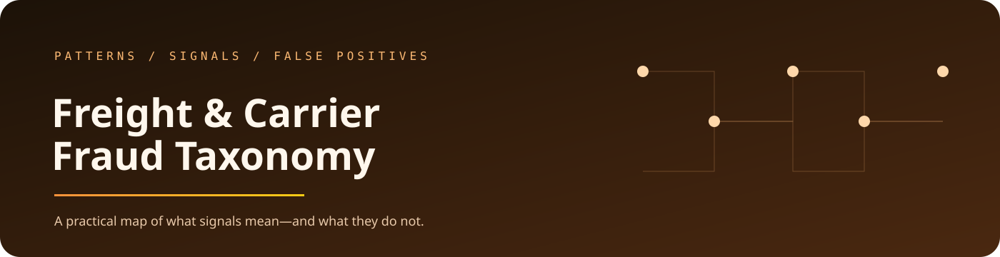

  

  <a href="https://jeevan-0508.github.io/freight-fraud-taxonomy/">Browse the taxonomy</a> ·
  <a href="docs/getting-started.md">Getting started</a> ·
  <a href="docs/quality-review.md">Quality review</a> ·
  <a href="#what-each-pattern-contains">Pattern structure</a> ·
  <a href="#use-it-with-the-tools">Use it with the tools</a>

# Freight & Carrier Fraud Risk Taxonomy

### A practical map of what signals mean—and what they do not.

This open taxonomy describes fraud and cargo-loss patterns in European road freight, with the observable signals, likely false positives, detection stage, and countermeasures needed to investigate them responsibly.

`12 PATTERNS` · `93 INDICATORS` · `31 FALSE POSITIVES` · `143 COUNTERMEASURES`

## Start with the taxonomy

**[Browse the live taxonomy →](https://jeevan-0508.github.io/freight-fraud-taxonomy/)**

Choose a pattern, inspect the signals that make it plausible, then read the benign explanations that could look identical. The false-positive block is not an appendix; it is part of the finding.

## What each pattern contains

<table>
  <tr>
    <td width="50%"><strong>Pattern</strong> What the behaviour looks like in an operational freight context.</td>
    <td width="50%"><strong>Signals</strong> What can actually be observed, and at which stage of the movement.</td>
  </tr>
  <tr>
    <td width="50%"><strong>False positives</strong> Innocent explanations that should be ruled out before escalation.</td>
    <td width="50%"><strong>Countermeasures</strong> Practical checks and interventions matched to the stage of risk.</td>
  </tr>
</table>

## Why the false positives matter

A regional GNSS interference event can look like a tracker being jammed. A last-minute dispatch change can look like double brokering. A carrier assigned repeatedly to one lane can look suspicious for reasons that have nothing to do with fraud.

The taxonomy is built to slow down the confident wrong call and make the next useful observation easier to choose.

## Use it with the tools

[Freight Risk Atlas](https://github.com/Jeevan-0508/freight-risk-atlas) turns the taxonomy into an assessment workflow. [Fraud Watch](https://github.com/Jeevan-0508/fraud-watch) places signals inside a synthetic living world. [RISK//MESH](https://github.com/Jeevan-0508/Risk-Mesh) connects the evidence and outcome story.

<strong>Scope and provenance</strong>

This is an open structured reference for portfolio and research use. It is not legal advice, a carrier score, or a substitute for an organisation’s investigation policy and local expertise.

The repository currently does not bundle an application screenshot; the browsable taxonomy above is the source of truth for the experience.

Built by <a href="https://github.com/Jeevan-0508">Jeevan Siddhabhaktula</a> · <a href="LICENSE">CC BY 4.0 licensed</a>

